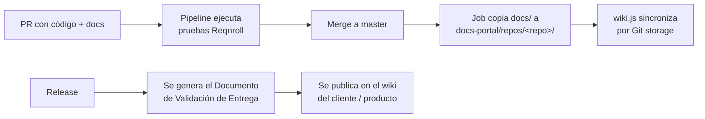

# docs/ — Mapa de la documentación

Este directorio contiene los lineamientos de SCISA. Aplica la misma estructura a la carpeta `docs/` de **cualquier repositorio de proyecto**: el portal wiki.js la usa como índice ([07.9](./programming/0.7.repositories/07.9.docs_portal.md)).

Punto de entrada general: [developer_guidelines.md](./developer_guidelines.md).

## Estructura esperada en un repositorio de proyecto

```
/docs
├── README.md                ← este mapa, adaptado al proyecto
├── adr/                     ← decisiones de arquitectura (0001-titulo.md)
└── assets/                  ← diagramas e imágenes
```

Los `.feature` viven en `tests/**` (proyecto Reqnroll); la documentación de features se genera a partir de ellos ([2.8](./programming/0.2.code_standards/2.8.reqnroll_documentation.md)).

## Qué documentación se exige y cuándo

| Documento | Cuándo | Guía |
|---|---|---|
| `.feature` en `tests/**` | Cada PR que cambia comportamiento | [05.15](./programming/0.5.collaborative_work/05.15.spec_first_workflow.md), [2.7](./programming/0.2.code_standards/2.7.bdd_documentation.md) |
| `CHANGELOG.md` | Cada PR; una entrada por versión | [07.2](./programming/0.7.repositories/07.2.releases.md) |
| **Documento de Validación de Entrega** | **Cada release y hotfix** | [05.17](./programming/0.5.collaborative_work/05.17.delivery_validation_doc.md) |
| ADR | Decisión arquitectónica | [05.9](./programming/0.5.collaborative_work/05.9.standard_docs.md) |
| Manual de usuario | Cambio visible al usuario | [05.10](./programming/0.5.collaborative_work/05.10.user_manual_standard.md) |

## Cómo se publica (despliegue de la documentación)



| Qué | Cómo llega al portal | Quién |
|---|---|---|
| `docs/` del repo | Automático al mergear a `master` (job de pipeline → `docs-portal` → Git storage de wiki.js). Mientras no exista el job: sincronización manual | Pipeline / DevOps |
| Documento de Validación de Entrega | Se genera del release y se publica en `Entregas / v<versión>` del wiki del cliente o producto. **No se guarda en el repo** | TL |
| Wikis de cliente y manuales | Se editan directo en el portal | TL del cliente |

Reglas:

1. Lo que viene de un repo **solo se edita por PR** en ese repo; una edición en el portal se pierde en la siguiente sincronización.
2. Solo se publica lo que está en `master`.
3. Cada `docs/` debe tener su `README.md` con el mapa de su contenido.

## Cómo se genera la documentación desde Reqnroll

1. Los `.feature` viven en `tests/**` ([2.8](./programming/0.2.code_standards/2.8.reqnroll_documentation.md)).
2. Lo que cambió entre releases sale del diff de los `.feature` entre tags de git; no hay versionado aparte.
3. Un generador (en evaluación: [spike](./process-proposals/doc_generator_evaluation.md)) produce el documento de entrega.
4. Hasta que exista: plantilla [013.5](./programming/0.13.templates/013.5.delivery_validation_template.md), llenada a mano.

## Checklist de entrega (resumen)

- [ ] `.feature` de `tests/**` consistentes con el código
- [ ] `CHANGELOG.md` de la versión completo
- [ ] Tag de git de la versión anterior existente (base del diff)
- [ ] Pruebas Reqnroll ejecutadas en el pipeline del release
- [ ] Documento de Validación de Entrega publicado en el wiki
- [ ] Gateway de entrega ([05.12](./programming/0.5.collaborative_work/05.12.delivery_gateway.md)) aprobado
