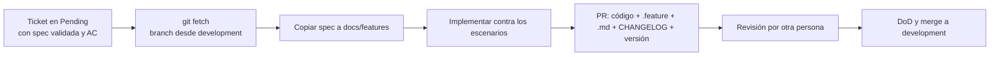

# Ruta de inducción: cómo se empieza a trabajar en SCISA

Esta guía es para quien se incorpora (o cambia de equipo). No hay que memorizarla: hay que saber **dónde ir a consultarla**.

> **La documentación es la forma de iniciar cualquier trabajo.** Antes de escribir código se lee la spec; antes de tomar un ticket se verifica que esté Ready.

## 1. Antes del primer día: accesos

Solicita (o confirma con tu líder) acceso a:

- [ ] Repositorios (Azure DevOps / GitHub según el proyecto). Se clona **siempre con SSH** ([guía de configuración](./01.5.instalation.md#6-autenticación-y-acceso-a-repositorios-ssh-de-azure)).
- [ ] ClickUp (tickets, sprint, specs).
- [ ] Herramienta de registro de actividades (ver [sección 7](#7-registro-de-actividades)).
- [ ] Wiki / portal de documentación ([07.9](../0.7.repositories/07.9.docs_portal.md)).
- [ ] Stack Overflow Teams (solo consulta: su contenido se está migrando al portal).
- [ ] Entorno de desarrollo instalado ([01.5](./01.5.instalation.md)).

## 2. Qué leer, en orden

1. [CONTEXT.md](../../../CONTEXT.md): quién es SCISA, equipos, productos, glosario.
2. [01.7 Contexto de productos](./01.7.product_context.md): SIGLO CD, SIGLO PLD, Identity, Common, multi-tenant.
3. [06.1 Convenciones de ramas (Gitflow)](../0.6.git/06.1.branching_gitflow.md).
4. [05.15 Flujo Spec-First](../0.5.collaborative_work/05.15.spec_first_workflow.md), [DoR](../0.5.collaborative_work/05.3.DoR.md) y [DoD](../0.5.collaborative_work/05.5.DoD.md).
5. [06.3 Commits](../0.6.git/06.3.commits_rules.md) y [06.4 Pull Requests](../0.6.git/06.4.pullrequest.md).
6. El `README.md` y la carpeta `docs/` del repositorio donde vas a trabajar.

## 3. Reglas que se aplican desde el primer día

### Git

- **Haz `git fetch` siempre que vayas a tocar un repositorio**, incluso si solo vas a consultar. Te dice qué ha pasado en el servidor.
- `master` es intocable: nunca se escribe directo, solo se integra por Pull Request validado.
- `development` es de trabajo: puede romperse, pero hay que cuidarlo. Se integra con PR.
- `releases/*` son *release candidates* que pasan por un ambiente pre-productivo (staging / QA). **La fuente de verdad es `master`.**
- Commits y PRs **pequeños**. Un PR grande no se puede revisar bien y frena a todo el equipo.
- Detalle completo: [06.1](../0.6.git/06.1.branching_gitflow.md). Excepción para librerías (Common): trunk simple.

### Qué debe tener todo repositorio

| Elemento | Para qué |
|---|---|
| `.gitignore` | Que no se suban binarios, documentos ni **secretos** (hoy se han publicado secretos por error: revísalo siempre). |
| `.editorconfig` | Reglas de formato compartidas (espacios/tabs, UTF-8, fin de línea LF/CRLF). Ya viene por defecto en VS y VS Code. |
| `src/`, `tests/`, `docs/` | Código, pruebas, documentación. En proyectos nuevos `tests/` y `docs/` son obligatorios. Ver [2.4](../0.2.code_standards/2.4.project_structure.md). |
| `README.md` | Qué hace, cómo levantarlo, dónde está la documentación. |
| `CHANGELOG.md` | Qué cambió, redactado para humanos. |
| `Directory.Build.props` | Aquí se lleva la **versión** del aplicativo (.NET). |
| Contenedores de infraestructura interna | Imágenes internas (SQL Server de varias versiones, Redis, RabbitMQ, ActiveMQ, Mongo, Mailpit, Prometheus…). Son **internas, no para publicar**. Si hace falta otro (ej. Python), se agrega ahí. |

### Versión y CHANGELOG en cada PR

- Todo PR actualiza la versión ([SemVer](../0.7.repositories/07.3.semantic_versioning.md)) y el CHANGELOG, normalmente.
- El CHANGELOG tiene arriba una sección **Unreleased**; al liberar, alguien le pone versión y fecha (y opcionalmente un resumen de por qué se libera).
- Categorías: `Added`, `Changed`, `Deprecated`, `Removed`, `Fixed`, `Security`.
- Se enlaza el ticket y se escribe **en lenguaje funcional, con el mayor contexto posible, sin detalles técnicos**:

| ❌ Técnico | ✅ Funcional |
|---|---|
| "Se corrigió la conexión a BD: se usaba TLS 1.1 en lugar de 1.2" | "Se corrige un problema de conexión con la base de datos que impedía iniciar sesión" |

La skill `scisa-changelog` ayuda a generar la entrada.

### Revisión

- Tu PR **lo revisa otra persona** (y, cuando exista, un bot). Esa persona corre las pruebas, revisa la documentación y la calidad del código y te deja comentarios que debes atender.
- No arregles lo que esté fuera del alcance del ticket: **repórtalo** en un ticket nuevo.
- **Documenta todo lo que encuentres** (comportamientos raros, cachés, configuraciones) aunque no lo arregles. Sin distraerte del ticket.

## 4. Cómo se trabaja un ticket

- **Si el ticket no dice con qué criterios se considera exitoso, no lo empieces.** Regrésalo ([DoR](../0.5.collaborative_work/05.3.DoR.md)).
- Si tienes dudas del problema, participa en la **sesión de refinamiento** del ticket con el analista: ahí se define qué hacer antes de que lo tomes.
- Usa el flujo [Spec-First](../0.5.collaborative_work/05.15.spec_first_workflow.md).

## 5. Sprints y carga de trabajo

- Trabajamos en **sprints de 2 semanas** (una semana es muy poco).
- Antes de que empiece el sprint debes saber **toda tu carga del periodo**.
- **Avisa tu disponibilidad real** (exámenes, citas, vacaciones, medio tiempo). Con eso se decide cuánto trabajo cabe.
- Lo que está en el sprint es lo que se espera al final. Si algo no se va a lograr, se habla de inmediato, puntualmente, no al cierre.

## 6. Trabajo en pareja

Se recomienda que **todas las personas trabajen con una pareja, idealmente de perfiles mixtos** (analista + dev, dev + QA, senior + junior, DevHub + Innovación). Ver [05.4](../0.5.collaborative_work/05.4.Pair_programming.md) y [05.15](../0.5.collaborative_work/05.15.spec_first_workflow.md#trabajo-en-pareja).

## 7. Registro de actividades

Las actividades se registran en la herramienta de registro de la organización (se pueden importar desde el calendario). Para que se clasifiquen solas por proyecto, el título de la actividad sigue un formato.

> **Formato:** `P | <número de proyecto> | <tipo> | <descripción>`, por ejemplo `P | 3465 | DEV | Intro a SCISA`.

Lo que se registra es **en qué proyecto trabajaste**, no el detalle de commits.

## 8. Tu primera semana

| Día | Qué hacer |
|---|---|
| 1 | Accesos, entorno, lecturas de la sección 2, conocer a tu pareja. |
| 2 | Clonar el repositorio de tu proyecto, `git fetch`, recorrer su `README` y `docs/`, levantarlo local. |
| 3 | Asistir a una sesión de refinamiento de tickets (como observador). |
| 4–5 | Tomar un primer ticket **Ready** (con spec validada) y acompañado de tu pareja. |

## 9. Cosas que NO se hacen

- Tomar un ticket sin criterios de aceptación.
- Escribir directo a `master`.
- Subir secretos, contraseñas o documentos al repositorio.
- Hacer PRs gigantes o commits "WIP" sin limpiar.
- Corregir cosas fuera de alcance dentro del mismo PR.
- Dejar la documentación "para luego".

## 10. ¿Dónde pregunto?

- Dudas del proyecto: tu pareja → tu líder técnico → analista del proyecto.
- Dudas del estándar: este repositorio. Si falta algo, **agrégalo** (ver [01.4 Cómo mantener este documento](./01.4.maintaining.md)).
- Aprendizajes generales (errores, configuraciones): portal de documentación (wiki.js). Los artículos históricos de Stack Overflow Teams se consultan mientras se migran.
