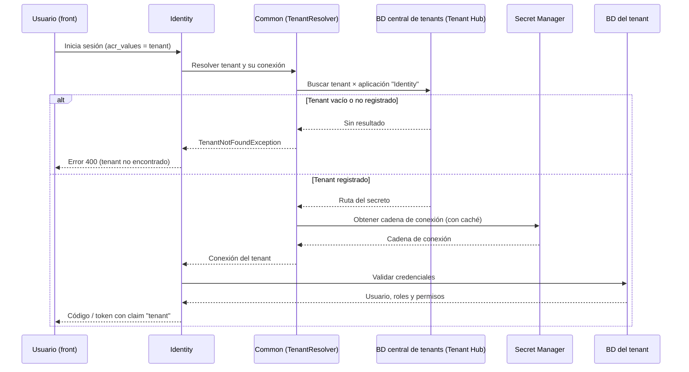
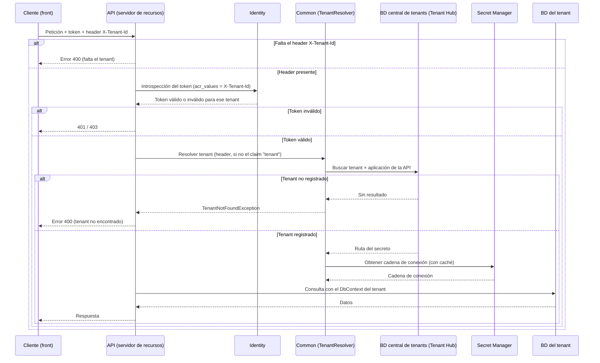

# Contexto de productos y arquitectura

Este documento da el contexto de negocio y arquitectura mínimo para entender sobre qué trabajamos. Complementa [CONTEXT.md](../../../CONTEXT.md) (organización, equipos, tracks).

> **Estado:** primera versión construida a partir de la inducción al área de Innovación. Las secciones marcadas con **Por completar** requieren aportes de quienes conocen el producto. Si encuentras algo incorrecto o faltante, corrígelo o agrégalo.

## 1. Productos principales

| Producto | Qué es | Modelo | Equipo |
|---|---|---|---|
| **SIGLO CD** | Sistema de Cambio de Divisas | Un fork por cliente (cada cliente es una variante) | DevHub (Operaciones) |
| **SIGLO PLD** | Sistema de Prevención de Lavado de Dinero. Nació del core de SIGLO CD | **Tronco**: versión compartida. **Enterprise**: fork dedicado por cliente | DevHub (Operaciones) |
| **Identity** | Servicio de autenticación y autorización (módulo de seguridad) | Multi-tenant (SaaS) | Innovación |
| **Common** (`SCISA_Common`) | Librerías compartidas (multi-tenant, mensajería, logging, etc.); resuelve el tenant de cada petición y su base de datos | Librería (NuGet interno) | Innovación |
| **Tenant Hub** | Administración de tenants: BD central de tenants y su catálogo de aplicaciones (en la documentación de Common aparece como *SCISA Metrics* / `SCISA_Metrics`: es el mismo sistema) | SaaS, en pausa, con mejoras pendientes | Innovación |

**Por completar:** módulos funcionales de SIGLO CD y SIGLO PLD (qué hace cada uno para el cliente), clientes por versión, calendarios de soporte.

## 2. Dos tracks tecnológicos

Ver tabla completa en [CONTEXT.md](../../../CONTEXT.md#dos-tracks-tecnológicos).

| | Legacy (on-premise) | SaaS (en adopción) |
|---|---|---|
| Backend | .NET Framework 4.8/4.5, WCF (SOAP) | .NET Core |
| Frontend | WPF; algunos PLD con MVC 5 + Blazor | Vue 3 |
| Despliegue | Instalación por cliente, Windows Server + IIS | Contenedores en Google Cloud Run |
| Modelo | Un despliegue por cliente | Multi-tenant |

**SIGLO.NET** es una aplicación de escritorio (WPF) que se comunica con servicios SOAP (WCF) del backend. WCF es una tecnología de alrededor de 2010 anterior a la adopción generalizada de REST (≈2012–2014). Esto explica buena parte de su forma de autenticación y sus límites de seguridad.

## 3. Multi-tenant

Un **tenant** es una instancia de cliente dentro de un aplicativo SaaS.

Existen dos formas de aislar datos entre tenants:

| Estrategia | Cómo | Cuándo se usa |
|---|---|---|
| Columna de tenant | Todas las tablas tienen una columna que indica a qué tenant pertenece cada fila | Baja exigencia de aislamiento |
| **Base de datos por tenant** | Cada cliente tiene su propia base de datos | **Estrategia de SCISA**, por temas regulatorios y para que los datos no se mezclen |

En SCISA: **la aplicación es una sola, pero por aplicativo y por cliente existe una base de datos.** Un mismo aplicativo puede tener *N* bases de datos idénticas (una por cliente).

Existe una **base de datos central de tenants** (la administra el **Tenant Hub**) que dice, para un tenant y una aplicación, dónde está su base de datos. Lo que se guarda ahí no es la cadena de conexión sino la **ruta a un secreto en Google Secret Manager**, donde vive la cadena de conexión real. **Common** no guarda tenants: contiene la **lógica** que resuelve el tenant de cada petición y obtiene la conexión.

| Pieza | Responsabilidad |
|---|---|
| **Tenant Hub** | Administra la BD central: `Customer` (empresa-cliente y su `TenantId`), `AppCatalog` (aplicaciones) y `TenantAppCatalog` (ruta del secreto por tenant × aplicación) |
| **Google Secret Manager** | Guarda la cadena de conexión de cada tenant × aplicación |
| **Common** | `TenantResolver` (determina el tenant de la petición) y `ScisaTenantComponent` (busca en la BD central y trae el secreto, con caché) |
| **Identity** | Valida credenciales y tokens contra la BD del tenant |

> **No confundir "cliente" con "tenant":** un cliente real puede tener varios tenants (por ejemplo, distintas empresas de un mismo grupo).

### 3.1 Inicio de sesión en Identity

El tenant llega en `acr_values` (URL de autorización, formulario de `/connect/token` o código de autorización cacheado). Identity valida las credenciales en la base de datos del tenant.

### 3.2 Petición a un servidor de recursos (API)

Aquí el tenant **no** viene en `acr_values`: el cliente lo envía en el header `X-Tenant-Id`. Primero se elige el tenant, luego se valida el token **contra ese tenant** (introspección en Identity) y, si pasa, se resuelve la conexión del tenant.

### 3.3 Modo single-tenant

Los despliegues de **PLD en el cliente** corren en modo `Single`: un pod por tenant, con el `TenantId` y la conexión fijos en su configuración. No se consulta la BD central.

### 3.4 Qué falta validar

Esta sección se contrastó con la documentación y el código de `SCISA_Common` (`docs/multi-tenant.md`, `docs/architecture.md`, `TenantResolver`, `ScisaTenantComponent`, `AuthorizeMiddleware`, `PrepareIntrospectionRequestHandler`). Pendiente de confirmar con Innovación:

- **Código de error cuando no existe el tenant:** en Common `TenantNotFoundException` se responde como **400**. El comportamiento histórico de **500** que se observó en Identity debe revisarse en su propio repositorio.
- **Orden header vs token:** el `TenantResolver` toma primero el header `X-Tenant-Id` y después el claim `tenant` del token. Common no compara ambos; la validación del token contra el tenant ocurre en la introspección de Identity. Conviene verificar que un token válido para un tenant no pueda usarse con el header de otro (en particular, `PrepareIntrospectionRequestHandler` cachea la introspección por token). Se registrará como ticket en el backlog de Identity.

## 4. Piezas de la plataforma de identidad

- **Identity:** servidor de identidad (autenticación, autorización, flujos tipo OAuth/OpenID).
- **Servidores de recursos:** cualquier aplicativo que protege algún recurso (por ejemplo, un API).
- **Clientes:** el *front* o aplicación que consume esos recursos.
- **Common:** librería compartida; ayuda a resolver el tenant.
- **Consola de administración (Identity):** front de administración; algunos flujos son solo de navegador (redirecciones, selección de tenant, login, conexión, autorización).

## 5. Iniciativas vigentes (contexto, no compromiso)

- **Integrar Identity con SIGLO.NET** para mejorar la seguridad de la autenticación, que hoy tiene vulnerabilidades conocidas. (Hay un proyecto para un cliente específico.)
- **Modelo de permisos:** históricamente los permisos de una aplicación se guardaban **serializados en una sola columna**. Se está migrando a una tabla administrable: cada aplicación define un conjunto de permisos (un identificador, por ejemplo "capturar operación"), se asignan a roles o usuarios, y la API exige el permiso correspondiente para consumirse.
- **Licenciamiento y alcance** (usuarios, roles, aplicaciones): en revisión.
- **Documentación activa y pruebas** en los aplicativos nuevos: ver [05.15](../0.5.collaborative_work/05.15.spec_first_workflow.md).

## 6. Dónde está cada cosa

| Qué busco | Dónde |
|---|---|
| Cómo trabajar (ramas, PR, commits) | [06.1](../0.6.git/06.1.branching_gitflow.md), [06.3](../0.6.git/06.3.commits_rules.md), [06.4](../0.6.git/06.4.pullrequest.md) |
| Spec de un feature | `docs/features/` del repositorio |
| Por qué se decidió una tecnología | `docs/adr/` del repositorio |
| Estado de un cliente on-premise | Wiki del cliente ([07.7](../0.7.repositories/07.7.client_wiki_standard.md)) |
| Ambientes y URLs | [07.6](../0.7.repositories/07.6.environments.md), [07.8](../0.7.repositories/07.8.subdomain_management.md) |

## 7. Por completar

- Descripción funcional de SIGLO CD y SIGLO PLD por módulo.
- Diagrama de contexto de cada producto (C4 nivel 1).
- Diagrama de integración Identity ↔ SIGLO.NET.
- Mapa de repositorios (qué repo es qué, quién es dueño).
- Glosario de negocio financiero (operaciones, reportes regulatorios).
