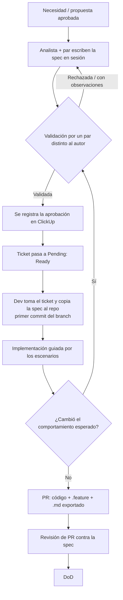

# Flujo Spec-First: la spec validada es el punto de partida

La documentación no se escribe después del trabajo: **es la forma de iniciar cualquier trabajo**. Antes de escribir código existe una spec en BDD, escrita en español, y validada por una persona distinta a quien la escribió.

> **Regla dura:** un ticket sin spec validada y sin criterios de aceptación **no está Ready**. No se toma, no se estima y no se empieza. Ver [DoR](./05.3.DoR.md).

## Por qué

- No tenemos documentación ni pruebas en la mayoría de las soluciones. Esto debe cambiar desde ahora, empezando por lo nuevo.
- Escribir los escenarios obliga a entender el problema **antes** de programar. Si no se pueden escribir, el análisis está incompleto.
- La spec es el contrato entre análisis, desarrollo, QA y negocio. Las pruebas se derivan directamente de ella.
- La spec es lo primero que lee quien se incorpora al equipo (ver [Ruta de inducción](../0.1.introduction/01.6.onboarding_path.md)).

## Dos niveles de spec

| Nivel | Cuándo | Qué define | Dónde vive primero | Dónde termina |
|---|---|---|---|---|
| **Spec de proyecto** | Todo proyecto nuevo, antes del primer sprint | Alcance: por qué existe, qué entra, qué **no** entra, actores, lista de features | ClickUp (épica / doc del proyecto) | `README.md` y `docs/` del repo |
| **Spec de feature** | Todo ticket que cambia comportamiento observable | Escenarios BDD de ese feature | ClickUp (ticket) | `docs/features/<feature>/` del repo |

Las specs se aprueban **fuera del repo (en ClickUp)**, donde se ve el alcance completo del proyecto. Conforme avanza el desarrollo, **van apareciendo en el repo**, versionadas junto al código.

## Flujo



1. **Se escribe en pareja.** El analista nunca escribe la spec solo: la trabaja en sesión con un par (desarrollo o QA). Ver [Trabajo en pareja](#trabajo-en-pareja).
2. **Se valida.** Una persona distinta a las autoras revisa la spec con el [checklist de validación](#checklist-de-validación).
3. **Se registra la aprobación en ClickUp** (comentario en el ticket o épica con: quién validó, fecha, resultado y versión de la spec). Sin ese registro el ticket no pasa a *Pending*.
4. **El dev copia la spec al repo** en el primer commit del branch (`docs/features/<feature>/<feature>.feature`) y desarrolla guiándose por ella.
5. **Si el comportamiento esperado cambia durante el desarrollo**, se actualiza la spec y se vuelve a validar (puede ser una revalidación breve, pero siempre por un par). El caso de desalineación se resuelve como indica [2.7](../0.2.code_standards/2.7.bdd_documentation.md).
6. **El PR** incluye código, `.feature` y `.md` exportado. El revisor compara escenarios contra implementación antes de revisar línea por línea.

## Spec de proyecto nuevo

Antes de abrir el repositorio y antes del primer sprint, el proyecto tiene una spec de alcance validada (en ClickUp). Contenido mínimo:

| Sección | Qué responde |
|---|---|
| Contexto y por qué | ¿Qué problema de negocio resuelve? ¿Quién lo pidió? ¿Qué pasa si no se hace? |
| Objetivo medible | ¿Cómo sabremos que funcionó? |
| Alcance: **sí entra** | Lista de features / capacidades |
| Alcance: **no entra** | Lo explícitamente excluido (evita cambios de alcance disfrazados) |
| Actores | Roles y sistemas externos |
| Features | Cada uno con su `.feature` (al menos el flujo principal y errores críticos; el detalle se completa antes de que cada feature entre a un sprint) |
| Dependencias y riesgos | Servicios, equipos, datos, decisiones pendientes |
| Requisitos no funcionales | Seguridad, rendimiento, multi-tenant, auditoría, si aplican |

Relación con los demás estándares: la spec de proyecto parte de la [propuesta](./05.11.proposal_checklist.md) y el [pre-análisis](./05.14.pre_analysis_standard.md); no los reemplaza.

## Idioma y formato: Gherkin en español

Todas las specs se escriben en español con la palabra clave de idioma al inicio:

```gherkin
# language: es
@INN-1542
Característica: Validación de tenant en el inicio de sesión

  Como usuario de un cliente SaaS
  Quiero que el sistema identifique mi organización al iniciar sesión
  Para acceder únicamente a la información de mi organización

  Antecedentes:
    Dado que existe el tenant "scisa" con su base de datos configurada

  Escenario: Inicio de sesión con tenant válido
    Cuando el usuario "carlos@scisa.com.mx" inicia sesión en el tenant "scisa"
    Entonces el sistema lo redirige a la página principal
    Y se utiliza la base de datos del tenant "scisa"

  Escenario: Tenant que no existe
    Cuando el usuario inicia sesión en el tenant "inexistente"
    Entonces el sistema muestra el mensaje "La organización no existe"
    Y el intento queda registrado en los logs

  Esquema del escenario: Contraseña inválida
    Cuando el usuario "<correo>" ingresa la contraseña "<contraseña>"
    Entonces el sistema muestra el mensaje "<mensaje>"

    Ejemplos:
      | correo              | contraseña | mensaje                    |
      | carlos@scisa.com.mx | vacía      | La contraseña es requerida |
      | carlos@scisa.com.mx | incorrecta | Credenciales inválidas     |
```

Palabras clave: `Característica`, `Antecedentes`, `Escenario`, `Esquema del escenario`, `Ejemplos`, `Dado`, `Cuando`, `Entonces`, `Y`, `Pero`.

Reglas:

- **Un solo estándar de idioma:** el lenguaje del negocio es el español. Los términos del dominio se definen en el [glosario](../0.13.templates/013.1.glossary.md) y se usan igual en specs, tickets, manuales y conversación.
- Los escenarios describen **comportamiento observable desde el actor**, no implementación interna (nada de nombres de clases, tablas o endpoints en los pasos).
- Valores concretos (correos, estados, montos) en lugar de descripciones abstractas.
- Un escenario = una regla de negocio. Nombre del escenario en una frase que se entienda sin leer los pasos.
- Etiquetas: `@<ticket>` (trazabilidad, ej. `@INN-1542`), `@pendiente` (comportamiento planeado aún no implementado, con nota), `@critico` (flujo que no debe romperse).
- **Términos de negocio en inglés en el código existente:** el código existente no se renombra en bloque ni por iniciativa propia. **Cuando un feature se va a modificar, se migra completo al español** (spec, mensajes y nombres de dominio de ese feature), para no dejarlo mezclado. Así se converge poco a poco a un solo estándar (ver Terminología abajo).

### Terminología (un solo estándar)

El español del glosario es la fuente. Cuando el código ya use un término de negocio en inglés, se registra la equivalencia en el glosario del proyecto (`docs/glosario.md`) y, **al modificar un feature, se migra ese feature completo** al término acordado en español. No se hacen renombrados masivos fuera de un ticket: lo que no se toca, queda como está.

Ejemplo de tabla de equivalencias de un proyecto:

| Término del negocio (español) | Identificador en código actual |
|---|---|
| Permiso | `Permission` |
| Tenant (se conserva como término técnico aceptado) | `Tenant` |

> Los identificadores técnicos (clases, métodos, columnas) siguen las [convenciones de nombres](../0.2.code_standards/2.3.naming_conventions.md). Lo que se unifica es el **lenguaje del negocio**, no la sintaxis del código.

## `.feature` como fuente y `.md` exportado

| Archivo | Rol | Quién lo edita |
|---|---|---|
| `docs/features/<feature>/<feature>.feature` | **Fuente de verdad** de los escenarios | Personas (spec validada) |
| `docs/features/<feature>/<feature>.md` | Documentación legible y publicable. Contexto (descripción, actores, reglas, notas) + **escenarios exportados desde el `.feature`** | Contexto: personas. Bloque de escenarios: se genera |

El bloque exportado va entre marcadores y **no se edita a mano**:

```markdown
<!-- feature:start -->
... escenarios generados desde <feature>.feature ...
<!-- feature:end -->
```

El pipeline de PR valida que el bloque exportado coincida con el `.feature` (si el `.feature` cambió y el `.md` no, el PR falla). Hasta que exista la herramienta de exportación, el bloque se genera de forma manual o con apoyo de una skill. Ver [07.9 Portal de documentación](../0.7.repositories/07.9.docs_portal.md).

Estructura completa de la plantilla en [13.4](../0.13.templates/013.4.feature_template.md).

## Checklist de validación

El validador **no es quien escribió la spec**. Es cualquier par con contexto suficiente para leerla (dev, QA, otro analista). Valida con:

- [ ] Se entiende el **por qué** (contexto de negocio) sin preguntar a las autoras.
- [ ] Cada escenario se puede **reproducir manualmente** leyéndolo. Si no, es demasiado vago: se rechaza.
- [ ] Hay valores concretos, no abstracciones.
- [ ] Cubre flujo feliz, casos borde y errores relevantes.
- [ ] Nada de implementación interna en los pasos.
- [ ] Usa el vocabulario del glosario; no mezcla sinónimos.
- [ ] Está explícito lo que **no** entra al alcance.
- [ ] Los criterios de aceptación del ticket son verificables (Sí / No).
- [ ] Las dependencias y los datos de prueba están identificados.
- [ ] Los escenarios no se contradicen entre sí ni con features existentes.

Resultados posibles: **Validada**, **Validada con observaciones menores** (no cambian comportamiento) o **Rechazada** (regresa a escritura). Se registra en ClickUp.

## Trabajo en pareja

- **Recomendación general:** todas las personas trabajan con una pareja, idealmente de **perfiles mixtos** (analista + dev, dev + QA, senior + junior, DevHub + Innovación). Ver [Pair programming](./05.4.Pair_programming.md).
- **Obligatorio para specs:** el analista que trabaja la spec la escribe con un par. Nadie escribe y valida su propia spec.
- La pareja que escribe **no** es quien valida. Validar es una tercera mirada.

## Proyectos y features existentes (sin spec)

No se detiene la operación por no tener specs históricas. Regla de avance:

1. Todo ticket que toque un feature existente **sin** spec debe incluir primero una spec que describa el comportamiento actual (caracterización) y la validación de un par.
2. Después se escribe la spec del cambio.
3. Así la cobertura crece donde se trabaja, hasta cubrir lo crítico.

## Del escenario a la prueba

- Cada escenario debe poder convertirse en una prueba (manual al inicio; automatizada con un framework BDD que soporte español, ej. Reqnroll, cuando el equipo lo adopte).
- Los proyectos nuevos tienen carpeta de pruebas desde el primer commit. Ver [pruebas automáticas mínimas](../0.7.repositories/07.4.minimum_automated_tests.md).

## Sesiones de refinamiento de tickets

Los tickets se co-desarrollan: se hace una sesión (analista + dev/par) donde se define el problema, los escenarios y los criterios de aceptación; de ahí sale la spec y el ticket. No se esperan tickets vagos ("error") para que cada quien interprete. El ticket resultante usa la skill [`ticket-template`](../../../skills/ticket-template/SKILL.md) e incluye: **contexto (por qué)**, **spec validada (enlace)** y **criterios de aceptación**.

## Pendientes

- Herramienta de exportación `.feature` → `.md` y validación en pipeline.
- Skill para generar spec + ADR + diagrama desde una conversación (apoyada en `grill-with-docs`).
- Definir framework de pruebas BDD para .NET y Vue.
