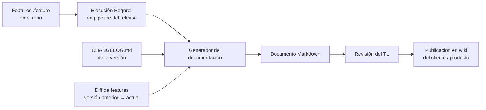

# Documento de Validación de Entrega

Todo entregable que sale de SCISA hacia QA o hacia el cliente viaja con un **Documento de Validación de Entrega**. Quien recibe la entrega debe poder responder, leyendo solo este documento: *¿qué cambió?, ¿qué voy a validar? y ¿sobre qué escenarios funciona?*

> **Regla de alcance:** lo que no aparece en el documento no se entregó. Si alguien encuentra un comportamiento que no está en el documento, se considera **fuera de alcance**: nunca se validó ni se prometió.

Este documento es lo que algunos equipos llaman "matriz de pruebas". Aquí se estandariza el nombre, el contenido y cómo se genera.

---

## Cuándo es obligatorio

| Entrega | ¿Documento? |
|---|---|
| Release a QA interno o a cliente (`releases/v<x>`) | **Sí, siempre** |
| Hotfix | **Sí**, versión corta (secciones 1, 2, 3 y 5; solo lo que toca el fix) |
| Entrega parcial / demo de avance | Recomendado |

**Sin documento no hay entrega.** Es punto de verificación del [Gateway de entrega](./05.12.delivery_gateway.md): su ausencia es No-Go.

---

## Dónde vive

El documento **no se guarda en el repositorio**. Se genera a partir del repositorio y se publica en el wiki de destino:

| Track | Destino | Visibilidad |
|---|---|---|
| Legacy on-premise (SIGLO CD, PLD Enterprise) | Wiki del cliente ([07.7](../0.7.repositories/07.7.client_wiki_standard.md)), sección de historial de versiones | Cliente |
| SIGLO PLD Tronco | Wiki centralizado de Tronco | Cliente |
| SaaS | Wiki del producto en el portal ([07.9](../0.7.repositories/07.9.docs_portal.md)) | Cliente |

Cada versión tiene su propia página: `Entregas / v<versión>`. El enlace se registra en la columna *Changelog* del historial de versiones del wiki del cliente.

Lo que sí vive en el repo es su **fuente**: los `.feature` de `tests/**` y el `CHANGELOG.md`. Ver [2.8](../0.2.code_standards/2.8.reqnroll_documentation.md).

---

## Contenido obligatorio

### 1. Datos de la entrega

| Campo | Ejemplo |
|---|---|
| Producto / cliente | SIGLO PLD — Cliente X |
| Versión | v2.4.0 |
| Fecha de entrega | 2026-11-05 |
| Ambiente de validación | QA — URL |
| Responsable de la entrega | Nombre (TL) |
| Tickets incluidos | Enlaces a ClickUp |

### 2. Resumen de cambios

Redactado para negocio, no para desarrolladores. Se toma del `CHANGELOG.md` de la versión.

| Tipo | Cambio | Ticket |
|---|---|---|
| Nuevo | Bloqueo de cuenta tras 5 intentos fallidos | [TICKET] |
| Modificado | La búsqueda de personas ahora incluye RFC | [TICKET] |
| Corregido | El reporte mensual duplicaba registros | [TICKET] |
| Eliminado | Exportación a formato obsoleto | [TICKET] |

### 3. Escenarios a validar

El corazón del documento. **Una fila por escenario**, generada desde los `.feature`. Agrupada por feature.

| Feature | Escenario | Estado en la entrega | Resultado automatizado | Validación QA/cliente |
|---|---|---|---|---|
| Autenticación | Inicio de sesión exitoso | Sin cambios | ✅ | ☐ |
| Autenticación | Bloqueo tras 5 intentos fallidos | **Nuevo** | ✅ | ☐ |
| Búsqueda de personas | Búsqueda por RFC | **Modificado** | ✅ | ☐ |

- **Estado en la entrega:** `Nuevo`, `Modificado` o `Sin cambios` (regresión). Se obtiene comparando los `.feature` entre el tag de git de la versión anterior y el de la actual (sin versionado adicional).
- **Resultado automatizado:** resultado de la última ejecución de Reqnroll sobre el release. Si el escenario no está automatizado: `Manual`.
- **Validación QA/cliente:** la completa quien recibe. Es la evidencia de que se validó.
- Cada escenario enlaza a su detalle (pasos Gherkin con valores concretos) para que se pueda reproducir.

Los escenarios pendientes (`@pendiente`) no aparecen aquí: van en la sección 5. Los escenarios **eliminados** tampoco: se listan como `Eliminado` en la sección 2 (resumen de cambios).

### 4. Datos y precondiciones de prueba

Usuarios, roles, catálogos o configuración necesarios para ejecutar los escenarios en el ambiente de validación.

### 5. Fuera de alcance y limitaciones conocidas

- Comportamiento planeado pero no entregado, con su ticket.
- Limitaciones conocidas y errores abiertos aceptados para esta versión.
- Lo explícitamente excluido en la spec del proyecto ([05.15](./05.15.spec_first_workflow.md)).

Esta sección es la que protege al equipo y al cliente: lo que está aquí se sabía, y se acordó.

### 6. Instrucciones de despliegue / actualización

Solo si el cliente despliega por su cuenta (on-premise): pasos, scripts de migración, orden de ejecución, rollback. Referencia: [07.5 Validación pre y post deploy](../0.7.repositories/07.5.Pre_and_postdeployment_validation.md).

### 7. Firma

| Rol | Nombre | Fecha | Resultado |
|---|---|---|---|
| TL SCISA | | | Go / No-Go |
| QA / Cliente | | | Aceptado / Observaciones |

---

## Cómo se produce

1. El pipeline del release ejecuta las pruebas Reqnroll y guarda el reporte de ejecución.
2. El generador ([2.8](../0.2.code_standards/2.8.reqnroll_documentation.md)) combina: escenarios, resultados, `CHANGELOG.md` y diff de features entre tags.
3. El **TL revisa** el borrador: completa secciones 4, 5 y 6 (las que no se generan).
4. Se publica en el wiki antes del Gateway de entrega.

La herramienta de generación está en evaluación ([spike](../../process-proposals/doc_generator_evaluation.md)). Mientras no exista el generador automático, el documento se arma con la plantilla [013.5](../0.13.templates/013.5.delivery_validation_template.md), copiando los escenarios de los `.feature`. La estructura no cambia; solo cambia quién la llena.

---

## Responsabilidades

| Rol | Responsabilidad |
|---|---|
| Desarrollador | `.feature` y `CHANGELOG.md` al día en cada PR (sin esto no hay materia prima) |
| TL | Revisa, completa y publica el documento; lo presenta en el Gateway |
| QA / Cliente | Valida los escenarios y registra el resultado; reporta como hallazgo lo que no está en el documento |
| PM | Verifica que existe antes de co-firmar el Go |

## Qué hacer con hallazgos fuera del documento

Si QA o el cliente reporta algo que no está en el documento:

1. Si es un **defecto** en un escenario listado → bug, se corrige.
2. Si es comportamiento **no listado** → no es defecto de la entrega. Se registra como nuevo requerimiento (ticket Feature), con su spec ([05.15](./05.15.spec_first_workflow.md)).
3. Si el escenario **debía** estar listado (estaba en la propuesta) → desalineación; cuenta como falla del Gateway en el [KPI de entregas](./05.13.delivery_kpi.md).
