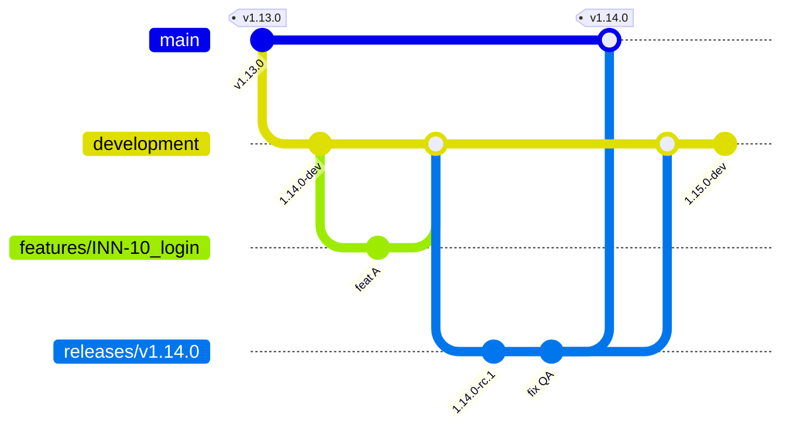

# Convenciones de ramas (Gitflow)

Git-flow es un modelo de manejo de ramas. Define ramas específicas para cada propósito y cómo deben interactuar. Su objetivo es agilizar el desarrollo, gestionar los lanzamientos de forma efectiva y facilitar la colaboración entre los miembros del equipo.

SCISA usa una **variante extendida** de Gitflow que agrega ramas de soporte (`STS/*` y `LTS/*`) para mantener versiones anteriores de clientes mientras se sigue liberando versiones nuevas.

## Glosario

| Término | Significado |
|---|---|
| **Long-lived** | Ramas principales (`master`, `development`). Viven todo el ciclo de vida del proyecto. |
| **Short-lived** | Ramas que se eliminan después de usarse (`features/*`, `releases/*`, `hotfixes/*`). |
| **PR** | Pull Request. Intención de integrar una rama en otra. Ver [Pull Requests](./06.4.pullrequest.md). |
| **Tag** | Etiqueta anotada sobre `master` que marca una versión liberada (`v1.14.0`). |

---

## Ramas



> En el diagrama `main` representa a `master`.

### `master`

- Rama principal. Cada nodo representa una **versión liberada** lista para producción.
- Solo se integran aquí ramas `releases/*` y `hotfixes/*`.
- Cada versión liberada lleva un **tag**.
- No todas las versiones liberadas llegan necesariamente al cliente.
- **TODO lo que se libere al cliente sale de `master`**, incluso un ambiente de QA del cliente.

> **¿Por qué no liberar desde `releases/*` a un QA del cliente?**
> No controlamos el ambiente del cliente: una versión de QA podría terminar en producción. Las versiones de `releases/*` son "casi listas", no finales. Para garantizar consistencia y calidad, solo sale lo que está en `master`.

### `development`

- Recopila la funcionalidad nueva. Aquí se integran las `features/*` ya completadas.
- Es estable, pero **puede contener funcionalidad que no está lista para producción**.
- Su versión siempre lleva sufijo `-dev` (ver [Versionamiento en ramas](#versionamiento-en-ramas)).

### `features/<num_ticket>_<ticket_name>`

- Short-lived. Una rama por funcionalidad, enfocada en **UN SOLO feature**.
- Nace de `development` y regresa a `development` vía PR.

Reglas para `<ticket_name>`:

- Solo minúsculas, números y guiones bajos.
- Sin acentos, `ñ` ni caracteres especiales.
- Mínimo 1 palabra, máximo 4.

Ejemplo: `features/INN-1542_validar_cancelacion`

### `releases/v<version>`

- Short-lived. Sirve para **preparar una liberación**: pruebas finales, bug fixes y ajustes de la versión.
- Mientras un equipo prepara la liberación, otro puede seguir trabajando en nuevas funcionalidades sobre `development`.
- Nace de `development`. Al terminar se integra a `master` y se regresa a `development`.
- **Solo se aceptan bug fixes y ajustes menores. No se agregan features.**
- Se elimina al hacer merge a `master`.

> ### ⚠️ ADVERTENCIA: quitar funcionalidad en un release para un cliente
>
> Cuando un cliente no quiere cierta funcionalidad, a veces se **elimina del release** para que `master` salga sin ella (casos Bancrea, Actinver, Bajío, etc.).
>
> **Esta práctica DEBE detenerse.** Es una excepción peligrosa, no un flujo válido:
>
> - Lo que se quita en el release **viaja a `master`**, por lo que `master` deja de ser la fuente de verdad de lo que se liberó.
> - Si se hace merge de regreso a `development`, **se perdería la funcionalidad para todos**. Si no se hace, `master` y `development` divergen.
> - Rompe la regla de que todo sale de `master` con un historial consistente.
>
> **Alternativa correcta:** la funcionalidad opcional debe ir detrás de configuración o feature flag, de modo que el código sea el mismo para todos y el cliente la active o no.
>
> **Mientras no exista esa alternativa en el proyecto** (solución temporal):
>
> 1. El back-merge a `development` **NO** debe incluir los cambios que quitan funcionalidad. Usar **cherry-pick de los bug fixes únicamente** y no hacer merge completo.
> 2. Documentar en el PR del release qué se quitó, por qué y para qué cliente.
> 3. Escalar con el Tech Lead antes de proceder.
>
> Los clientes viven en repositorios distintos, por lo que **no se crean ramas por cliente**.

### `hotfixes/<num_ticket>_<ticket_name>`

- Short-lived. Fix de **bugs críticos en producción** que no pueden esperar al próximo release.
- Nace de `master` (del tag de la versión afectada).
- Sube **solo el PATCH** de la versión.
- Se integra a `master` y se lleva a `development` (ver flujo de [Hotfix](#hotfix)).

### `STS/v<version>` (Short Term Support)

- Aplica principalmente a **SIGLO CD**.
- Se usa cuando el cliente está en una versión anterior (ej. 1.4) pero ya existe una versión más nueva en `master` (ej. 1.5).
- Agrupa las versiones anteriores que necesitan soporte puntual.
- Short-lived: cuando termina su ciclo se deja de mantener. Puede quedar como histórico, **no es necesario eliminarla**.
- **No debe recibir soporte por mucho tiempo.** Si se libera una STS, hay que buscar la forma rápida de llevar al cliente de vuelta a `master`.

### `LTS/v<version>` (Long Term Support)

- Aplica principalmente a **SIGLO PLD Tronco**, donde una misma versión sirve a múltiples clientes.
- Da soporte a versiones específicas **sin agregar funcionalidad nueva**.
- En SIGLO CD no tiene tanto sentido porque la versión cambia con las necesidades del cliente.

---

## Versionamiento en ramas

Para poder distinguir una versión en producción de una en desarrollo (ej. un `1.14.1` en `master` vs. uno en `development`), las ramas **no liberadas** usan sufijo de pre-release de [SemVer](../0.7.repositories/07.3.semantic_versioning.md):

| Rama | Formato | Ejemplo |
|---|---|---|
| `development` | `X.Y.Z-dev` | `1.15.0-dev` |
| `releases/*` | `X.Y.Z-rc.N` | `1.14.0-rc.1`, `1.14.0-rc.2` |
| `master` | `X.Y.Z` (sin sufijo) | `1.14.0` |
| `hotfixes/*` | `X.Y.Z` (PATCH) | `1.14.1` |

Orden de precedencia: `1.14.0-dev` < `1.14.0-rc.1` < `1.14.0`.

Reglas:

- **Un número sin sufijo existe únicamente en `master`.** Si ves `1.14.1`, es una versión liberada.
- Cada build de QA sobre una rama `releases/*` incrementa `rc.N`.
- Al terminar un release, `master` recibe la versión final sin sufijo y `development` se actualiza a la siguiente versión `-dev`.
- Al llevar un hotfix a `development`, **se conserva la versión `-dev`** de `development` (se resuelve el conflicto de versión a favor de `development`).
- En .NET el sufijo vive en `InformationalVersion` / `PackageVersion`. `AssemblyVersion` y `FileVersion` no admiten sufijos.

---

## Flujos de trabajo

### Desarrollo de un feature

```bash
git fetch
git checkout development
git pull origin development
git checkout -b features/<num_ticket>_<ticket_name>

# ... trabajo ...
git commit -m "<summary>" -m "<description>"
git push origin features/<num_ticket>_<ticket_name>
```

Antes de abrir el PR, revisar el propio cambio:

- **SÍ** hacer los refactors necesarios.
- **SÍ** eliminar código sin uso.
- **SÍ** reportar mejoras o bugs encontrados (en un ticket nuevo).
- **NO** arreglar cosas fuera del propósito del ticket.

Abrir PR hacia `development`. Ver [commits](./06.3.commits_rules.md) y [Pull Requests](./06.4.pullrequest.md).

### Preparar un release

```bash
git fetch
git checkout development
git pull origin development

# Crear la rama de release y fijar la versión rc
git checkout -b releases/v1.14.0
# cambiar versión a 1.14.0-rc.1
git commit -m "chore(release): bump version 1.14.0-rc.1"
git push origin releases/v1.14.0

# Abrir la siguiente versión de desarrollo
git checkout development
# cambiar versión a 1.15.0-dev
git commit -m "chore(release): bump version 1.15.0-dev"
git push origin development
```

Sobre la rama de release:

1. Publicar a ambiente interno de SCISA.
2. Hacer validaciones de QA.
3. Aplicar cambios y bug fixes del release (cada build incrementa `rc.N`).

### Liberar (release)

```bash
git fetch
git checkout releases/v1.14.0
git pull origin releases/v1.14.0
```

1. Fijar versión final `1.14.0` y abrir **PR a `master`**.
2. Validar el PR; aceptarlo si todo está correcto.
3. Eliminar la rama de release al hacer merge.
4. Etiquetar:

```bash
git fetch
git checkout master
git pull origin master
git tag -a v1.14.0 -m "Release v1.14.0"
git push origin v1.14.0
```

5. Llevar los cambios del release de regreso a `development` (bug fixes por **cherry-pick**; ver la advertencia de [releases](#releasesversion)).
6. Publicar la versión y enviarla al cliente **desde `master`**.

### Hotfix

```bash
git fetch
git checkout master
git pull origin master
git checkout -b hotfixes/<num_ticket>_<ticket_name>

# bump de PATCH, ej. 1.14.1
git add .
git commit -m "<summary>" -m "<description>"
git push origin hotfixes/<num_ticket>_<ticket_name>
```

1. Abrir **PR a `master`**, validar y aceptar. La rama se elimina al hacer merge.
2. Etiquetar:

```bash
git checkout master
git pull origin master
git tag -a v1.14.1 -m "Release v1.14.1"
git push origin v1.14.1
```

3. Publicar y enviar al cliente desde `master`.
4. **Llevar el hotfix a `development`**: hacer **rebase de la rama del hotfix sobre `development`** y abrir un PR hacia `development`.

```bash
git checkout hotfixes/<num_ticket>_<ticket_name>
git fetch
git rebase origin/development
git push --force-with-lease origin hotfixes/<num_ticket>_<ticket_name>
# abrir PR hacia development
```

   El rebase se aplica a la **rama del hotfix** (rama personal, no compartida), nunca a `development`. Esto asegura que:
   - El hotfix se aplique sobre `development` y **no arrastre cambios de `master`** (por ejemplo, funcionalidad que se quitó para un cliente pero que sí se quiere más adelante).
   - La integración se haga después vía PR con merge, sin reescribir `development`.
   - Se conserve la versión `-dev` de `development`.

   Por lo tanto, en este paso la rama del hotfix **no se elimina** hasta que el PR a `development` esté integrado.

### Hotfix sobre una versión anterior (cliente en 1.4, `master` en 1.5)

1. Crear la rama desde el **tag** de la versión del cliente:

```bash
git fetch --tags
git checkout -b hotfixes/v1.4.1 v1.4.0
```

2. Aplicar los fixes y subir PATCH (`1.4.1`).
3. Crear `STS/v1.4.1` con el cambio y publicar **desde `STS/v1.4.1`**.
4. Integrar el fix a `master` (PR) y llevarlo a `development` con el rebase descrito en el flujo de hotfix.
5. Cuando el cliente migre a la versión vigente, la STS deja de mantenerse.

---

## Resumen de ramas

| Rama | Origen | Destino | Se elimina | Versión |
|---|---|---|---|---|
| `master` | — | — | No | `X.Y.Z` + tag |
| `development` | — | — | No | `X.Y.Z-dev` |
| `features/*` | `development` | `development` (PR) | Sí | — |
| `releases/*` | `development` | `master` + `development` | Sí | `X.Y.Z-rc.N` |
| `hotfixes/*` | `master` (tag) | `master` + `development` (PR vía rebase) | Sí, tras llegar a `development` | `X.Y.Z` (PATCH) |
| `STS/*` | tag en `master` / `hotfixes/*` | `master` + `development` | No (histórico) | `X.Y.Z` |
| `LTS/*` | tag en `master` | — | No | `X.Y.Z` |

## Relacionado

- [Reglas para commits](./06.3.commits_rules.md)
- [Pull Requests](./06.4.pullrequest.md)
- [Merging, rebase, squash](./06.5.merge_rebase_squash.md)
- [Protección y roles en repositorios](./06.6.repository_roles.md)
- [Versionamiento semántico](../0.7.repositories/07.3.semantic_versioning.md)
