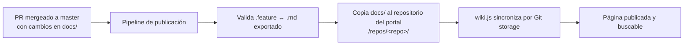

# Portal de documentación (wiki.js)

Hoy gran parte de la documentación vive en Google Drive y no la encuentra nadie. La decisión es **consolidar toda la documentación en un solo portal basado en wiki.js**, alimentado desde los repositorios.

> **Decisiones:**
> - **wiki.js es la herramienta para todo.** Docusaurus queda **deprecado**.
> - La **fuente de verdad** de la documentación técnica y de features sigue siendo **el repositorio**. El portal la *publica*, no la reemplaza.
> - Google Drive deja de ser origen de documentación: se inventaría y se migra o archiva (ver [plan de consolidación](../../process-proposals/docs_consolidation_epic.md)).

## Qué contiene el portal

| Espacio | Contenido | Fuente | Acceso |
|---|---|---|---|
| **Lineamientos** | Este repositorio (`org-guidelines`) | Repo | Interno |
| **Repositorios** | `docs/` de cada repo: features (.md exportado), ADRs, diagramas, README | Repo (sincronizado) | Interno |
| **Clientes** | Wiki por cliente on-premise ([07.7](./07.7.client_wiki_standard.md)) | Editado en el portal | Interno / Cliente |
| **Manuales de usuario** | Manuales por producto/módulo ([05.10](../0.5.collaborative_work/05.10.user_manual_standard.md)) | Editado en el portal o repo | Cliente (lectura) |
| **Inducción** | Ruta de inducción y contexto de producto | Este repo | Interno |

Permisos: dos niveles, **Interno** (por defecto) y **Cliente**, como en 07.7. Si hay duda, es interno.

## Cómo llega la documentación del repositorio al portal



1. **Qué se publica:** el contenido de `docs/` de cada repositorio en `master` (lo liberado). Lo que está en `development` o en ramas no se publica.
2. **Mecanismo recomendado:** el portal usa el módulo de **Git storage** de wiki.js apuntado a un repositorio dedicado (`docs-portal`). Un job del pipeline de cada repo copia `docs/` a `docs-portal/repos/<repo>/` al mergear a `master`. Alternativa mientras no exista el pipeline: sincronización manual.
3. **No se edita a mano en el portal** lo que viene de un repo (se pisaría en la siguiente sincronización). Los cambios se hacen por PR en el repo origen.
4. Lo que no es de ningún repo (wikis de cliente, manuales) se edita directamente en el portal.
5. Para que el portal sirva de índice, cada `docs/` tiene un `README.md` con el mapa de su contenido.

> **Por validar en una prueba de concepto:** renderizado de bloques Mermaid y de bloques Gherkin en wiki.js, y la estructura de rutas del Git storage.

### Estructura propuesta

```
/
├── lineamientos/            ← org-guidelines
├── repos/
│   ├── identity/
│   │   ├── features/
│   │   ├── adr/
│   │   └── README
│   └── common/
├── clientes/
│   └── <cliente>/           ← 07.7
├── manuales/
│   └── <producto>/<modulo>/
└── induccion/
```

## Reglas de contenido

- Español. Formato Markdown. Diagramas en Mermaid.
- Un documento = un tema. Título claro. Enlaces relativos entre documentos del mismo repo.
- Nada de secretos, contraseñas ni datos de clientes sensibles en páginas con nivel Cliente. Credenciales viven en la bóveda, no en el portal.
- Todo documento tiene dueño (el repo o el TL del cliente) y fecha de última revisión visible.

## Responsabilidades

| Rol | Responsabilidad |
|---|---|
| Autor del PR | Que `docs/` del repo esté al día (DoD) |
| Revisor del PR | Que la documentación sea coherente con la implementación |
| DevOps / Infraestructura | Operar wiki.js, backups, el pipeline de publicación |
| TL de cliente | Wiki del cliente ([07.7](./07.7.client_wiki_standard.md)) |
| Comité técnico (pendiente de constituir) | Estructura del portal, criterios de archivado |

## Qué pasa con las demás fuentes

| Fuente actual | Destino |
|---|---|
| Google Drive | Inventario → migrar a repo o portal / archivar (plan de consolidación) |
| Docusaurus (manuales) | Migrar a wiki.js. Sin nuevos sitios Docusaurus |
| Stack Overflow Teams | Se inventarían sus artículos y se migran a wiki.js. Mientras tanto se consulta, pero **no se crean artículos nuevos** |

## Pendientes

- Prueba de concepto de wiki.js (hosting, SSO, Git storage, Mermaid, búsqueda).
- Pipeline de publicación `docs/` → `docs-portal`.
- Definir dueños del portal y del archivado.
- Migrar los artículos vigentes de Stack Overflow Teams y apagar la herramienta.
